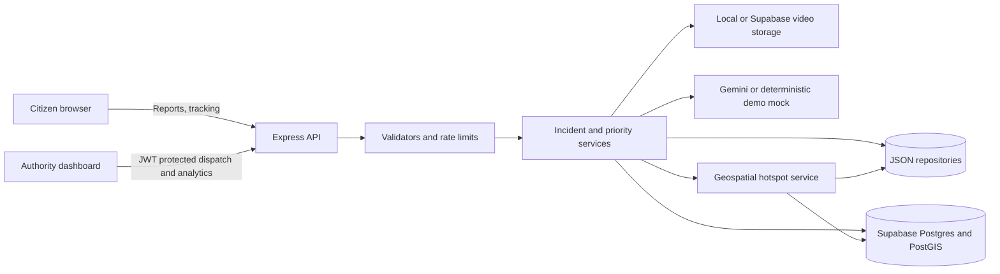

# RescueGrid

> **Emergency Incident Reporting & Monitoring Platform**  
> Built for **Code Clash 2026, Round 1: "Emergency Incident Reporting & Monitoring"**

RescueGrid bridges on-the-ground citizens and municipal disaster response authorities in real time. Citizens submit emergency incidents with geolocation and danger context, while an autonomous rule-based severity engine classifies threat levels. Incident commanders monitor real-time queues, dispatch statuses, and analytical charts in a dark gold emergency theme.

---

## Tech Stack & Architecture

- **Frontend**: React 18, Vite, Tailwind CSS (Black & Gold Theme), React Router v6, Axios, Recharts, Lucide React
- **3D Hero**: Three.js via `@react-three/fiber` and `@react-three/drei` (rotates slowly with `prefers-reduced-motion` accessible fallbacks)
- **Backend**: Node.js + Express REST API (CORS, Helmet, Morgan, Express-Rate-Limit)
- **Storage**: Persistent JSON file repository (`backend/data/incidents.json`) accessed strictly via `backend/repository.js` (zero-database dependency, 100% Windows compatible)
- **Security & Triage**: JWT Bearer auth for authority endpoints, rate-limited public reporting, pure rule-based severity scoring algorithm

---

## Quick Start (Windows PowerShell / CMD)

### 1. Prerequisites
- **Node.js**: v18+ (tested and verified on Node.js v24.21.0 & npm 11)

### 2. Install Dependencies

In **Terminal 1** (Backend):
```powershell
cd backend
npm install
```

In **Terminal 2** (Frontend):
```powershell
cd frontend
npm install
```

### 3. Seed Database & Run Unit Tests
```powershell
cd backend
npm run seed
npm test
```
*Inserts 12 realistic sample incidents across all 6 disaster categories and 4 severities.*

### 4. Start Applications

**Start Backend (Port 5000):**
```powershell
cd backend
npm start
```
*API runs at `http://localhost:5000`*

**Start Frontend (Port 5173):**
```powershell
cd frontend
npm run dev
```
*Open `http://localhost:5173` in your browser.*

---

## Authority Demo Credentials

Configured in `backend/.env`:
- **Username**: `admin`
- **Password**: `rescuegrid2026!`
- **Login URL**: `http://localhost:5173/authority/login` *(Use the 1-click "Quick Fill Demo Credentials" button)*

---

## 10-Point Deliverable Checklist

| # | Deliverable Requirement | Status | Verification Detail |
|---|-------------------------|--------|---------------------|
| 1 | **Emergency Reporting** | Passed | Citizen portal at `/report` with Title (min 5 chars), Description (min 20 chars with counter), Category cards, People Affected counter, and Contact inputs. |
| 2 | **GPS Geolocation** | Passed | One-click "Use my current location" via Geolocation API with graceful denial fallback; records latitude and longitude coordinates. |
| 3 | **Contextual Risk Questions** | Passed | Includes "Are people trapped?", "Is anyone in immediate danger?", and "Are there injuries?" labeled *unverified, as reported by you*. |
| 4 | **Data Persistence** | Passed | Incidents are saved atomically to `backend/data/incidents.json` via `backend/repository.js`, persisting across server restarts. |
| 5 | **Rule-Based Severity Engine** | Passed | `backend/severity.js` deterministically calculates score (0-3 Low, 4-6 Medium, 7-9 High, 10+ Critical) with keyword detection and override rules; verified with 8 unit tests. |
| 6 | **Citizen Confirmation & Tracking** | Passed | `/report/success/:id` and `/track` show Incident ID, severity badge, score, itemized reasons, status timeline, and the mandatory 112 disclaimer notice. |
| 7 | **Safe Field Sanitization** | Passed | Public tracking endpoint omits personal contact details; text inputs stripped of harmful scripts. |
| 8 | **Authority Authentication** | Passed | `/authority/login` authenticates credentials and issues signed JWT token protecting all `/api/admin/*` routes. |
| 9 | **Interactive Command Dashboard** | Passed | `/authority` displays 3D-tilt stat cards, 6-category Recharts bar chart, severity distribution chart, searchable/filterable table, and 15-second auto-refresh. |
| 10 | **Incident Lifecycle Management**| Passed | Slide-over panel tracks Reported, Assigned, In Progress, and Resolved with an audit timeline, severity override, map link, and deletion modal. |

---

## 2-Minute Demo Walkthrough Script

1. **Step 1: Open Public Landing Page (`http://localhost:5173/`)**
   - Point out the 3D rotating wireframe globe hero, the persistent 112 emergency banner, and the 3D tilt effect on the portal cards.
2. **Step 2: Submit a Critical Emergency (`/report`)**
   - Click **"Report an Emergency"**.
   - Select category: **"Building Collapse"**.
   - Enter title: `Partial structural collapse at North Station concourse`.
   - Enter description: `Main concrete pillar cracked. 7 shoppers trapped under debris, toxic gas leak odor reported.`.
   - Enter People Affected: `7`.
   - Set "Are people trapped?": **Yes**.
   - Set "Immediate danger to life?": **Yes**.
   - Click **"Use my current location"** or enter address: `4th & Market St, North Entrance`.
   - Click **"Submit Emergency Report"**.
3. **Step 3: Review Real-Time Algorithmic Triage (`/report/success/:id`)**
   - Observe the **Critical** badge with pulsing indicator.
   - Note the breakdown of reasons (e.g. *Building Collapse (+3)*, *People trapped (+3)*, *Critical keyword 'trapped' (+2)*, *Gas leak critical override*).
   - Copy the generated Incident ID (e.g. `INC-XXXXX`).
4. **Step 4: Public Tracking Verification (`/track`)**
   - Click **"Track Incident"** in the top navigation.
   - Paste the ID and search: confirm severity score, reasons, and status timeline appear without exposing private phone numbers or emails.
5. **Step 5: Authority Login (`/authority/login`)**
   - Click **"Authority Login"**.
   - Click **"Quick Fill Demo Credentials"** (`admin` / `rescuegrid2026!`) and sign in.
6. **Step 6: Dashboard Triage & Monitoring (`/authority`)**
   - Point out the top 3D-tilt stat cards and the gold Recharts category and severity charts.
   - Observe the newly reported Critical incident automatically positioned at the top of the table with red highlights.
   - Test the category, severity, and text search filters.
7. **Step 7: Incident Management & Lifecycle Updates**
   - Click **"Manage"** on your reported incident to open the management panel.
   - Click **"View Map"** to verify OpenStreetMap link.
   - Change Status to **"In Progress"** with note `Emergency Rescue Squad 3 dispatched` and click **"Update Status"**.
   - Click **"Override Severity"**, set to **"High"** with justification `Perimeter stabilized by on-scene battalion chief`, and apply.
   - Notice the toast confirmation and both the original and overridden severities logged in the audit trail.
8. **Step 8: Delete Report**
   - Scroll to the bottom of the panel, click **"Delete Report"**.
   - Confirm in the modal prompt (`"This cannot be undone"`).
   - Verify the incident is removed and stats update immediately.

## Offline Demo Mode

Set `DEMO_MODE=true` and `STORAGE_DRIVER=json` in `backend/.env` to force local JSON storage and deterministic mocked AI analysis. Start the backend, then run `npm run seed` from the repository root. The seed creates sample incidents and 10 response teams near Tirupati; it includes older reports so the priority queue has visible age differences. If Gemini is unreachable, the AI analysis service returns its deterministic mock result. If Supabase is unreachable, JSON storage handles incidents, teams, hotspots, and media metadata; uploaded video files use local disk storage. The frontend and backend should be on the same machine for local video playback.

## Final Demo Script

1. Seed with `npm run seed`, sign in at `/authority/login`, and open the authority dashboard. The sample queue should show priority scores and labels; the seed includes reports with different ages and two Busy sample teams.
2. To trigger a hotspot, submit three reports from `/report` with coordinates within the configured radius (default 1 km) during the configured window (default 60 minutes). The hotspot alert is created after the third nearby report; use the same location and vary the incident details.
3. Attach a short valid MP4, WebM, or QuickTime video to a report. The backend validates file signature and size, then runs Gemini analysis when configured. In `DEMO_MODE`, it shows deterministic mock analysis instead.
4. With `DEMO_MODE=true`, disconnect venue Wi-Fi: the app keeps JSON persistence and local media playback; AI analysis uses its deterministic mock. In normal Supabase mode, a live Supabase outage interrupts database-backed API requests. Use `GET /api/health/db` to confirm the active driver.

## Architecture



## Security Review Notes

- Frontend code uses only the public API origin; Supabase service role and Gemini credentials are read by the backend. Do not add those values to `VITE_*` variables.
- The schema enables RLS on every table, including teams and assignment history, and defines no public policies. Backend database access uses the service role.
- Public incident tracking and map responses omit direct contact fields; map coordinates are fuzzed. Team administration is mounted behind authority JWT authentication.
- Video uploads are constrained by MIME type, magic-byte signature, and 50 MB maximum size. Public report submission is rate limited.
- CORS allows only the configured `CLIENT_ORIGIN`.
